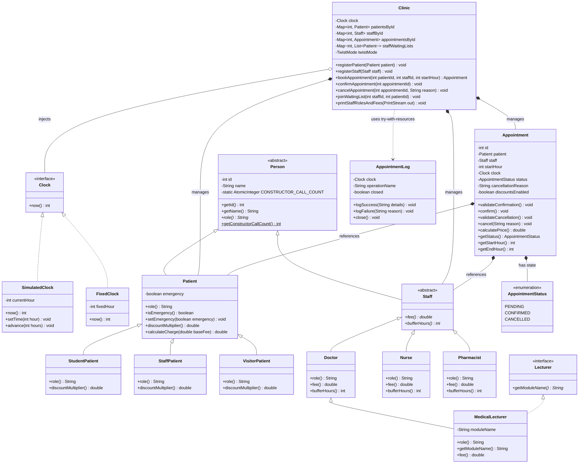

# Clinic Appointment System (Mini Project)

[](https://openjdk.org/projects/jdk/21/)
[](https://maven.apache.org/)
[](https://junit.org/junit5/)
> A pure Object-Oriented Programming (OOP) console application built from scratch in Java 21 without external frameworks. Demonstrates encapsulation, class hierarchies, polymorphism, custom resource management (`try-with-resources`), clock isolation, and multiple inheritance restructuring.

---

## Table of Contents

1. [Project Overview](#project-overview)
2. [Technologies Used & Prerequisites](#technologies-used--prerequisites)
3. [Project Directory Structure](#project-directory-structure)
4. [Compilation, Testing, and Execution Guide](#compilation-testing-and-execution-guide)
5. [Class Diagram (Mermaid)](#class-diagram-mermaid)
6. [Core Object-Oriented Concepts](#core-object-oriented-concepts)
7. [Appointment Business Rules & Invariants](#appointment-business-rules--invariants)
8. [The Four Assigned Twists](#the-four-assigned-twists)
9. [Appointment Logging & Resource Management](#appointment-logging--resource-management)
10. [Multiple Inheritance & The Diamond Problem](#multiple-inheritance--the-diamond-problem)
11. [Design Decision Log (D1 to D6)](#design-decision-log-d1-to-d6)
12. [Five-Minute Demonstration Guide](#five-minute-demonstration-guide)
13. [Troubleshooting Guide](#troubleshooting-guide)

---

## Project Overview

The **Clinic Appointment System** is a university mini-project designed to showcase fundamental and advanced Object-Oriented Programming concepts in plain Java. 

### Key Highlights:
- **Zero Framework Bloat:** Built with plain Java 21 and standard libraries; no Spring Boot, JavaFX, Swing, or SQL databases.
- **Clock Isolation:** Clinic logic never reads the host operating system clock. All time queries flow through a decoupled `Clock` interface (`0` to `168` hours in a week).
- **Strict Encapsulation:** All fields are private, constructors validate invariants, direct status mutation is prohibited, and internal collections are protected via unmodifiable views.
- **Polymorphism:** Staff fees, roles, buffer requirements, and patient discounts use dynamic dispatch without runtime type inspection or type tags.
- **Guaranteed Logging:** Every clinic operation opens and closes an audit log session using Java's `try-with-resources` (`AutoCloseable`). Both successes and failures (e.g. `FAILED cancel #3: too late`) are recorded.
- **All 4 Twists Implemented:** Waiting lists, emergency booking bumping, staff buffer hours, and patient discount tiers are fully supported and dynamically selectable via configuration.

---

## Technologies Used & Prerequisites

### Technologies:
- **Language:** Java 21 (LTS)
- **Build Tool:** Apache Maven 3.9+
- **Test Framework:** JUnit 5 (Jupiter 5.10.5)
- **User Interface:** Console-based Command Line Interface (CLI)
- **Target OS:** Windows 10/11 (fully compatible across Linux and macOS)

### Prerequisites:
Ensure Java 21 and Maven are installed and available on your system `PATH`:
```powershell
java -version
mvn -version
```

---

## Project Directory Structure

```
clinic-appointment-system/
├── pom.xml                                    # Maven POM configured for Java 21 and JUnit 5
├── README.md                                  # Comprehensive architectural and usage documentation
├── DECISIONS.md                               # Detailed design decision log answering D1 to D6
├── AI_USAGE.md                                # Academic transparency and AI usage disclosure
├── src/
│   ├── main/
│   │   └── java/
│   │       └── com/
│   │           └── clinic/
│   │               ├── Main.java              # Application entry point (interactive and --demo mode)
│   │               ├── clock/                 # Clock abstraction and simulated time
│   │               │   ├── Clock.java         # Clock interface (now() returns hour 0-168)
│   │               │   ├── SimulatedClock.java# Mutable simulated clock for manual/interactive testing
│   │               │   └── FixedClock.java    # Deterministic immutable clock for unit tests
│   │               ├── config/                # System configuration and twist toggling
│   │               │   ├── ClinicConfig.java  # Holds parameter P and active TwistMode
│   │               │   └── TwistMode.java     # Enum for selectable twists (0, 1, 2, 3, ALL)
│   │               ├── exception/             # Strongly typed domain exceptions
│   │               │   ├── ClinicException.java
│   │               │   ├── ValidationException.java
│   │               │   ├── ConflictException.java
│   │               │   ├── CancellationException.java
│   │               │   └── LoggingException.java
│   │               ├── log/                   # Audit logging subsystem
│   │               │   ├── AppointmentLog.java# AutoCloseable audit session ([log] opened/closed)
│   │               │   └── LogEntry.java      # Immutable historical audit record
│   │               ├── model/                 # Domain entities and contracts
│   │               │   ├── Person.java        # Abstract base entity with ID, name, role(), counter
│   │               │   ├── Patient.java       # Base patient with polymorphic discount logic
│   │               │   ├── StudentPatient.java# Patient subtype: 50% discount
│   │               │   ├── StaffPatient.java  # Patient subtype: free (0% fee)
│   │               │   ├── VisitorPatient.java# Patient subtype: full price (100%)
│   │               │   ├── Staff.java         # Abstract practitioner: abstract fee() & bufferHours()
│   │               │   ├── Doctor.java        # Fee: 40 + 5*(P%5), Buffer: 2 hours
│   │               │   ├── Nurse.java         # Fee: 10 + (P%3), Buffer: 1 hour
│   │               │   ├── Pharmacist.java    # Fee: 5.0, Buffer: 0 hours
│   │               │   ├── Lecturer.java      # Interface defining academic module capability
│   │               │   ├── MedicalLecturer.java# Doctor implementing Lecturer (single inheritance)
│   │               │   ├── Appointment.java   # Booking aggregate enforcing lifecycle timing rules
│   │               │   └── AppointmentStatus.java # PENDING, CONFIRMED, CANCELLED
│   │               ├── service/
│   │               │   └── Clinic.java        # Scheduling manager, conflict checker, waiting queues
│   │               └── ui/
│   │                   └── ConsoleApp.java    # Menu-driven, crash-proof interactive console UI
│   └── test/
│       └── java/
│           └── com/
│               └── clinic/
│                   ├── AppointmentLifecycleTest.java            # Tests timing & state transitions
│                   ├── ClinicBookingConflictTest.java           # Double bookings & ID uniqueness
│                   ├── ClockBehaviourTest.java                  # Clock bounds and simulation
│                   ├── FeeAndPolymorphismTest.java              # OCP & polymorphic fee loop
│                   ├── LoggingTest.java                         # try-with-resources & failure logs
│                   ├── MedicalLecturerMultipleInheritanceTest.java # Single inheritance & counter
│                   ├── TwistWaitingListTest.java                # Twist 0 auto-reallocation
│                   ├── TwistEmergencyTest.java                  # Twist 1 emergency bumping
│                   ├── TwistBufferTest.java                     # Twist 2 staff buffer hours
│                   ├── TwistDiscountTest.java                   # Twist 3 patient discount tiers
│                   └── ValidationAndInvariantsTest.java         # Constructor validation & immutability
```

---

## Compilation, Testing, and Execution Guide

All commands run in Windows PowerShell.

### 1. Compile the Project
```powershell
Set-Location "C:\Users\user\Desktop\cliniic management system\clinic-appointment-system"
$env:JAVA_HOME = "C:\Program Files\Java\jdk-21.0.12"
$env:Path = "$env:JAVA_HOME\bin;$env:Path"
mvn clean compile
```

### 2. Run All JUnit 5 Tests
Runs the project's JUnit 5 tests:
```powershell
mvn test
```

### 3. Package into Executable JAR
```powershell
mvn package
```
Generates `target/clinic-appointment-system-1.0.0.jar`.

### 4. Run Interactive Console Application
```powershell
java -jar target/clinic-appointment-system-1.0.0.jar
```
Or directly using class files:
```powershell
java -cp target/classes com.clinic.Main
```

### 5. Run Automated 5-Minute Demonstration
To run the automated demonstration without manual menu inputs:
```powershell
java -jar target/clinic-appointment-system-1.0.0.jar --demo
```

---

## Class Diagram (Mermaid)



---

## Core Object-Oriented Concepts

### 1. Encapsulation & Information Hiding
- **Private Fields:** All fields in `Person`, `Staff`, `Appointment`, and `Clinic` are marked `private` (or `private final` where immutable).
- **Constructor Invariant Defense:** Constructors immediately reject invalid arguments (e.g. `id <= 0`, empty names, hours outside `[0, 167]`), throwing `ValidationException`.
- **State Machine Protection:** `Appointment.status` cannot be set directly. There is no `setStatus()` method. Transitions happen through validated `confirm()` and `cancel(reason)` methods, which obtain time from the appointment's injected `Clock`.
- **Collection Immutability:** Internal lists and maps within `Clinic` are never returned directly. All accessor methods wrap internal collections in `Collections.unmodifiableList(new ArrayList<>(...))`.

### 2. Inheritance & Class Hierarchies
- `Person` defines foundational attributes (`id`, `name`) shared across all clinic participants.
- `Patient` specializes `Person` for individuals receiving care, introducing emergency triage flags and discount rates.
- `Staff` specializes `Person` for healthcare practitioners, introducing polymorphic `fee()` and `bufferHours()` contracts.
- Concrete providers (`Doctor`, `Nurse`, `Pharmacist`) inherit shared identity while customizing their operational parameters.

### 3. Pure Polymorphism (No Runtime Type Inspection or Type Tags)
- **Fee Calculation:** The loop in `Clinic.printStaffRolesAndFees()` iterates over `List<Staff>`. Each element executes `staff.role()` and `staff.fee()` via dynamic method dispatch.
- **Buffer Calculation:** `Clinic` checks buffer constraints by invoking `staff.bufferHours()`.
- **Discounts:** The appointment charges are computed via `patient.calculateCharge(staff.fee())`.
- **Open-Closed Principle (OCP):** Introducing a new staff member (e.g. `Physiotherapist`) or patient tier (e.g. `SeniorPatient`) requires creating the new subclass. Zero changes are needed in `Clinic`, billing loops, or booking algorithms.

### 4. Interface Segregation & Abstraction
- The `Clock` interface decouples scheduling logic from the host operating system clock.
- The `Lecturer` interface separates academic responsibilities from clinical practitioner duties.

---

## Appointment Business Rules & Invariants

```
=========================================================================
INVARIANTS FOR Appointment:
1. Identifier Integrity: id > 0 and immutable.
2. Entity Associations: patient and staff are non-null and immutable.
3. Temporal Bounds: 0 <= startHour < 168. Duration is exactly 1 hour;
   endHour == startHour + 1 <= 168.
4. Status Encapsulation: status is private; transitions occur strictly
   via confirm() and cancel() business methods.
5. State Machine Constraints:
   - Initial state is always PENDING.
   - PENDING -> CONFIRMED (only if clock.now() < startHour).
   - PENDING -> CANCELLED (any time before startHour: clock.now() < startHour).
   - CONFIRMED -> CANCELLED (only if startHour - clock.now() >= 2).
   - CANCELLED is a terminal sink state; once CANCELLED, it can NEVER return.
   - No appointment can be cancelled once it has started (clock.now() >= startHour).
=========================================================================
```

```
=========================================================================
INVARIANTS FOR Clinic:
1. Global ID Uniqueness: Person and appointment IDs are positive and unique
   across the clinic; cancelled appointments continue to reserve their IDs.
2. Appointment IDs are allocated without colliding with registered people.
3. Single Booking Constraints (Standard):
   - A staff member cannot have more than one non-cancelled appointment at the same hour.
   - A patient cannot have more than one non-cancelled appointment at the same hour.
4. Schedule Bounds: All appointments satisfy 0 <= startHour < 168.
5. Clock Isolation: Clinic never queries the host OS clock. All time queries
   strictly call clock.now().
6. Encapsulation: Internal structures are private; accessors return unmodifiable views.
7. Audit Logging: Every mutating clinic operation runs inside an AppointmentLog
   try-with-resources block, ensuring exactly one open and one close event.
=========================================================================
```

---

## The Four Assigned Twists

All four twists are selectable via configuration setting (`Clinic.setTwistMode()` or Menu Option 9):

| Twist Mode | Description | Architectural Implementation |
| :--- | :--- | :--- |
| **Twist 0: Waiting List** | Patients join staff waiting queues. When an appointment is cancelled, the slot is automatically offered to the first waiting patient with no conflict as a new `PENDING` booking. | Managed via `Map<Integer, List<Patient>> staffWaitingLists` in `Clinic`. Upon cancellation, candidate patients are evaluated for conflicts and auto-booked. |
| **Twist 1: Emergency** | An emergency-flagged patient can bump a `PENDING` appointment at the same hour. The existing appointment is cancelled with reason `"bumped"`. A `CONFIRMED` appointment can never be bumped. | The clinic validates every conflict first, logs the booking, then cancels the pending booking. Confirmed bookings are rejected without changing either appointment. |
| **Twist 2: Buffer** | Doctors require 2 hours between appointments, Nurses 1 hour, Pharmacists 0 hours. | Defined via `public abstract int bufferHours()` on `Staff`. `Doctor` returns 2, `Nurse` returns 1, `Pharmacist` returns 0. Queried polymorphically without type checks. |
| **Twist 3: Discounts** | Students pay 50%, Staff-members pay 0%, Visitors pay 100% of the staff fee. | `Appointment` asks the patient to calculate its charge polymorphically when Twist 3 is selected; otherwise it charges the base staff fee. |

`ClinicConfig.setP(p)` selects the assigned twist from `P % 4` for newly created clinics and also sets the staff fee formulas' `P`. The console or `Clinic.setTwistMode()` can explicitly select a different twist for demonstration and testing.

---

## Appointment Logging & Resource Management

Every clinic action is tracked through `AppointmentLog`, which implements `AutoCloseable`:
```java
try (AppointmentLog log = new AppointmentLog(clock, "cancel #3")) {
    try {
        // Business logic execution
        log.logSuccess("Appointment #3 cancelled");
    } catch (Exception ex) {
        log.logFailure(ex.getMessage());
        throw ex;
    }
}
```

### Guarantees:
1. **Deterministic Lifecycle:** `AppointmentLog` is `AutoCloseable`; try-with-resources attempts one close on every completed operation, including exceptional exits.
2. **Failure Capture:** Unsuccessful operations are logged explicitly, e.g.:
   `[log] FAILED cancel #3: A confirmed appointment cannot be cancelled less than two hours before start`
3. **Logging failures:** Opening/writing/closing failures are surfaced as `LoggingException`. A write failure prevents a new clinic mutation from being committed. If failure logging also fails, that exception is suppressed on the original failure. A close failure is reported; when an operation already failed, Java attaches the close error as a suppressed exception. A failed logging channel cannot guarantee physical output; the program does not pretend otherwise.
4. **No computer-clock timestamp:** Entries use only the injected clinic `Clock` hour; they do not contain a wall-clock timestamp.

---

## Multiple Inheritance & The Diamond Problem

### The Problem in Multiple Class Inheritance
In languages allowing multiple class inheritance (e.g. C++), if class `MedicalLecturer` inherits from both `Doctor` and `Lecturer`, and both extend `Person`, a "Deadly Diamond of Death" occurs:
```
       Person
      /      \
  Doctor    Lecturer
      \      /
   MedicalLecturer
```
Without virtual inheritance, two distinct instances of `Person` are created in memory, leading to ambiguous member resolution (`ml.getId()`) and duplicate state.

### The Java Solution: Single Class Inheritance + Interface
Java eliminates diamond ambiguity by permitting single class inheritance combined with multiple interface implementations:
- `Lecturer` is restructured as an **interface**:
  ```java
  public interface Lecturer {
      String getModuleName();
  }
  ```
- `MedicalLecturer` extends `Doctor` and implements `Lecturer`:
  ```java
  public class MedicalLecturer extends Doctor implements Lecturer
  ```
- **Constructor Count Verification:** `Person`'s constructor contains an `AtomicInteger` tracking invocations. Our unit test proves that creating a `MedicalLecturer` executes `Person`'s constructor **exactly once**.
- **Fee Rationale:** `MedicalLecturer.fee()` returns `super.fee()` (the standard Doctor consultation fee). Patients visiting a clinic pay for medical diagnosis and care by a qualified physician; academic teaching responsibilities are salaried by the university and not billed to clinical patients.

---

## Design Decision Log (D1 to D6)

Refer to [DECISIONS.md](DECISIONS.md) for the complete design decision log covering:
- **D1:** Why the 2-hour rule lives in `Appointment.cancel()`.
- **D2:** Why Clock injection makes timing testable and avoids real-time delays.
- **D3:** Why adding `Pharmacist` required zero modifications to domain or billing code.
- **D4:** Rationale for `MedicalLecturer.fee()` and how Java interfaces prevent Person duplication.
- **D5:** Exception suppression behavior during logging failures under `try-with-resources`.
- **D6:** Justifications for waiting list ownership, emergency non-bumping of confirmed slots, polymorphic `bufferHours()`, and patient discount location.

---

## Five-Minute Demonstration Guide

### Running via Automated Flag
Execute:
```powershell
java -jar target/clinic-appointment-system-1.0.0.jar --demo
```

### Exact Demonstration Steps & Expected Behavior:
1. **Registering Entities:**
   Creates `VisitorPatient` Sarah (#1), `StudentPatient` John (#2), `Doctor` Dr. House (#10), `Nurse` Nurse Joy (#20), `Pharmacist` Bob (#30), and `MedicalLecturer` Prof. Watson (#40).
   *Verification:* The counter is reset just before creating Prof. Watson and reports `1`; Prof. Watson reports `"Doctor and Lecturer"`.
2. **Booking an Appointment:**
   Sarah Connor books Dr. House at Hour 15 (clock is 10). Initial status is `PENDING`.
3. **Confirming an Appointment:**
   Sarah confirms the newly booked appointment. Its ID is chosen to avoid collisions with registered people.
4. **Deliberate Failure #1 (Double Booking Conflict):**
   John Connor attempts to book Dr. House at the same Hour 15.
   *Result:* Cleanly rejected with `ConflictException: Staff Dr. Gregory House (#10) is already booked at hour 15`. Log records `FAILED book`.
5. **Deliberate Failure #2 (Late Cancellation Rule):**
   Clock advances to Hour 14 (1 hour before Hour 15). Attempting to cancel the confirmed appointment.
   *Result:* Cleanly rejected with `CancellationException: A confirmed appointment cannot be cancelled less than two hours before start`. The failure is logged with the actual appointment ID.
6. **Valid Cancellation & Twist 0 (Waiting List):**
   Clock is set to Hour 12 (3 hours before start). John Connor joins Dr. House's waiting list. Sarah cancels her appointment.
   *Result:* The cancelled appointment retains its ID. Clinic assigns the slot to John as a new `PENDING` appointment with a globally unique ID.
7. **Twist 1 (Emergency Bumping):**
   Sarah books Nurse Joy at Hour 20 (`PENDING`). Emergency patient Bruce Wayne books Nurse Joy at Hour 20.
   *Result:* Sarah's appointment is bumped and cancelled (`Reason: bumped`). Bruce's booking succeeds.
8. **Twist 2 (Staff Buffer Hours):**
   Dr. House is booked at Hour 15. Attempting to book Dr. House at Hour 16 (gap = 0h < 2h).
   *Result:* Cleanly rejected by buffer check.
9. **Twist 3 (Patient Discounts):**
   For Dr. House's $40.00 fee: Visitor pays $40.00 (100%), Student pays $20.00 (50%), Staff-member pays $0.00 (0%).
10. **Audit Log Inspection:**
    Displays full history with simulated clinic hours, `[SUCCESS]` and `[FAILED]` tags.

---

## Troubleshooting Guide

### 1. `invalid target release: 21` during Maven compile
* **Cause:** Maven is running with an older JDK (such as JDK 17).
* **Fix:** Point `JAVA_HOME` to JDK 21 before compiling:
  ```powershell
  $env:JAVA_HOME = "C:\Program Files\Java\jdk-21.0.12"
  $env:Path = "$env:JAVA_HOME\bin;$env:Path"
  mvn clean test
  ```

### 2. Maven dependency resolution in offline sandbox
* **Cause:** Maven attempts to download missing plugins without internet access.
* **Fix:** Run Maven with the offline flag `-o`:
  ```powershell
  mvn test -o
  mvn package -o
  ```

### 3. Invalid inputs during console usage
* **Protection:** The `ConsoleApp` input readers loop repeatedly until valid input is received. Letters entered for numerical inputs or blank strings will never crash the application.
